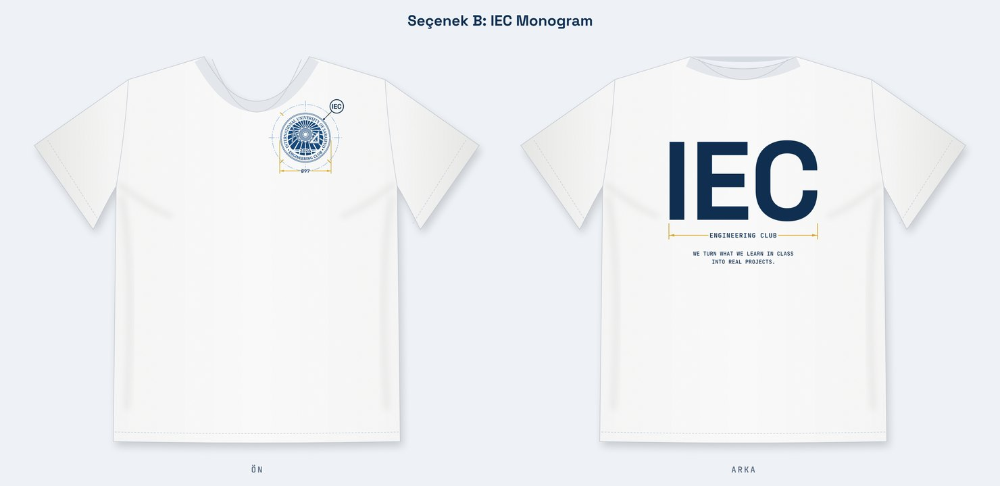
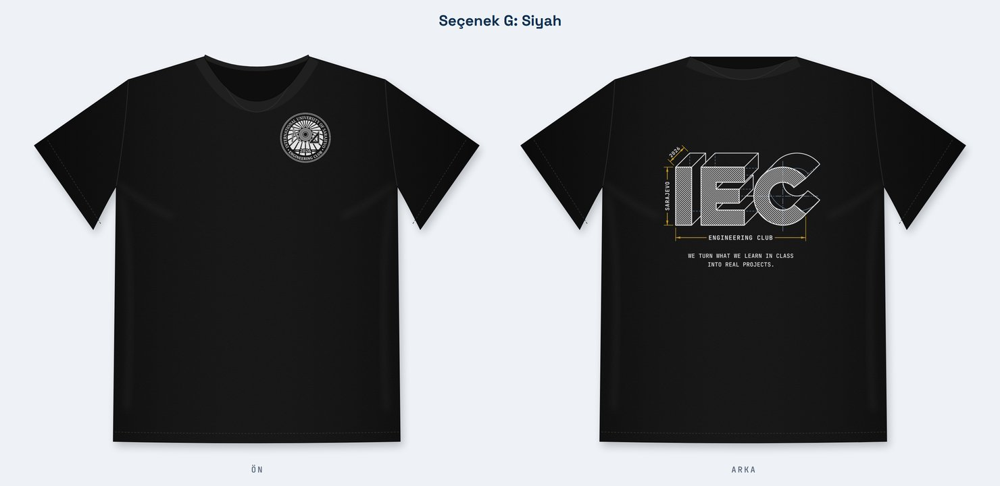

# IEC Tişört Sponsorluğu

IEC Engineering Club (Saraybosna) kulüp tişörtünün 3D sponsor sayfası.

**Sayfa:** https://hasankaan28.github.io/iec-tshirt/

Sponsorlar tişörtü seçer, döndürür, logolarını koymak istedikleri alanları işaretler ve kulübe gönderecekleri hazır mesajı alır. Sayfa kendi başına bir şey göndermez: mesaj iusengclub@gmail.com adresine e-postayla gider.

Bu tişört, IEC Pass kartında 10 damga toplayan üyelere verilir.

## Tişörtler

| | Tişört | Ön | Arka |
| --- | --- | --- | --- |
| B | Beyaz | Sol göğüste ölçü çizgili kulüp mührü | Büyük IEC monogramı ve slogan |
| G | Siyah | Sol göğüste beyaz kulüp mührü | 3B teknik resim olarak IEC: ENGINEERING CLUB × SARAJEVO × 2026 ölçüleri ve slogan |

Doğrudan bir tişörte link vermek için: `?shirt=G` (siyah) ya da `?shirt=B` (beyaz). Arkadan açmak için `&view=back` ekleyin.

3D model, düz kalıbı gövdeye sarar. Bu yüzden baskılar kumaş üstünde gerçek ölçüleriyle görünür.

## Sponsor alanları (yetişkin L beden)

| Alan | Ölçü |
| --- | --- |
| Ön göğüs, ana sponsor | 25 × 8 cm |
| Sağ göğüs | 8.5 × 3.5 cm |
| Sırt üstü | 20 × 4.5 cm |
| Sırt altı | 23 × 5.5 cm |
| Sol kol | 7.5 × 7.5 cm |
| Sağ kol | 7.5 × 7.5 cm |

İki tişörtte de alanlar aynıdır. Satılan bir alanı sayfada "Dolu" göstermek için `index.html` içindeki `TAKEN` listesine alanın kimliğini ekleyin (`front`, `chest`, `upper`, `lower`, `lsleeve`, `rsleeve`).

## English

A 3D page for sponsors of the IEC Engineering Club shirt in Sarajevo. Sponsors pick the white shirt (B) or the black shirt (G), turn it, choose the spots for their logo and get a ready message to send to iusengclub@gmail.com. The flat pattern is wrapped around the body, so prints show at their real size. The page is available in Turkish, English and Bosnian.
